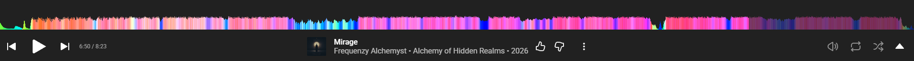
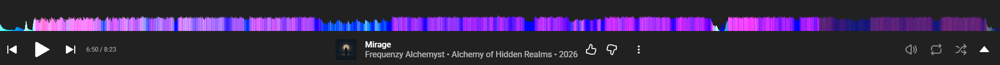
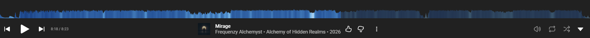
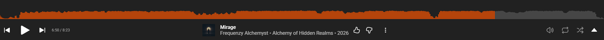

# Waveform Seekbar — a plugin for Pear Desktop

Replaces the Pear Desktop / YouTube Music player-bar progress slider with a
**SoundCloud / Rekordbox / Traktor-style waveform**. Click anywhere on it to seek.

The waveform is drawn from the real audio — per-bucket RMS for the body and true
peaks for the transient detail — and coloured by frequency content, so you can
read a track's structure at a glance (bass vs. mids vs. highs) just like on a CDJ.

> Theme names (SoundCloud, Rekordbox, Traktor) describe the **visual style** only.
> This project is not affiliated with or endorsed by SoundCloud, Pioneer DJ /
> AlphaTheta, Native Instruments, or YouTube.



## Features

- **Frequency-coloured waveform** — low → red, mid → green, high → blue (the
  standard DJ-software mapping), with vivid neon blends and a configurable warm/cool
  balance.
- **Real peak detail** — height uses true peaks, so kicks and transients spike like
  a real waveform instead of a flat RMS blob.
- **Complete, stable waveform (optional)** — fetch the whole track once and draw it
  all up front; seeking only moves the played marker, it never shifts bars or greys
  out. No Downloader plugin required.
- **Progressive mode (default)** — build the strip from the audio the player
  buffers, with zero extra network use.
- **12 themes in 3 families** (Basic / Rekordbox / Traktor), each with its native
  render style applied automatically.
- **Per-track height normalization** so quiet material (live recordings) still fills
  the strip.
- **Click or keyboard seek** — the waveform is a focusable slider (←/→ 5 s, Page Up/Down
  30 s, Home/End) with a visible focus ring and screen-reader value text.

## Themes

Grouped into sub-folders under **Theme**:

| Family | Theme | Look |
|--------|-------|------|
| **Basic** | SoundCloud | Solid orange, played / unplayed split |
| | YouTube Music | Solid red |
| | Monochrome | Solid white |
| | Album accent | Colour sampled from the current cover art |
| **Rekordbox** | RGB | Per-slice frequency colour — low → red, mid → green, high → blue |
| | 3-Band | Overlaid blue (low) / amber (mid) / white (high) envelopes |
| | Blue | Classic monochrome blue, brightening to white on transients |
| **Traktor** | Spectrum | Frequency RGB, Traktor-flavoured — more high emphasis, mids tinted cyan |
| | Infrared | Thermal ramp — deep red (bass) → orange → yellow / white (highs) |
| | Ultraviolet | Indigo (bass) → violet → magenta / white (highs) |
| | X-Ray | Navy (bass) → steel blue → white (highs) |
| | Blue (solid) | Solid Traktor cyan |

Picking a theme auto-selects its native render (continuous for the CDJ families,
bars for Basic); you can still override **Render** afterward.

A few more looks (same track, same spot — the banner above is Rekordbox RGB):

**Traktor Spectrum** — also frequency RGB, but cooler and cyan-leaning (more high
emphasis), so it reads differently from Rekordbox



**Traktor X-Ray** — navy → steel blue → white (brighter = higher frequencies)



**SoundCloud** — solid bars, played / unplayed split



## Settings

All under **menu bar → Plugins → Waveform Seekbar**:

| Setting | Options |
|---------|---------|
| Theme | the list above (Basic / Rekordbox / Traktor) |
| Bar height | Short / Medium / Tall / Full |
| Peak sensitivity | Flat (0) … Normal (1×) … Max (2.5×) — how far transients spike above the body |
| Color balance | Coolest … Neutral … Warmest — shifts hues cooler (less red) or warmer |
| Normalize height | On (fill the strip per track) / Off (true relative loudness) |
| Strip height | 32 / 40 / 48 / 64 px |
| Bar width | 1–4 px (bars render only) |
| Background | Transparent / Player colour |
| Shape | Centered (mirrored) / Bottom |
| Render | Bars / Continuous (Rekordbox) |
| Full waveform | On (fetch once, complete strip) / Off (progressive, default) |
| Max full-fetch length | 20 / 30 / 45 / 60 / 120 min / Unlimited — longer tracks skip the download and use progressive |
| Auto-fetch when a track can't be read | Off (default) / On — opt-in, progressive mode only: downloads a track that was resumed mid-way or cached so the strip isn't left grey |

### Full waveform vs. progressive

- **Progressive (default):** zero extra network use — the waveform is decoded from
  the bytes the player already streams, and grows as the track buffers. It can't
  show parts of the track you haven't reached yet.
- **Full:** the whole track is fetched once (audio-only) via a lightweight Innertube
  call and every bar is drawn straight away, so seeking into un-buffered parts is
  already rendered. Needs a playable track; if the fetch fails it silently falls
  back to progressive. Does **not** require the Downloader plugin.

## Install

> Pear Desktop discovers plugins by scanning `src/plugins/*/index.ts` **at build
> time**, so the plugin lives inside the app's source tree and the app is rebuilt
> from source — there is no prebuilt drop-in binary.

1. **Clone this repo and [Pear Desktop](https://github.com/pear-devs/pear-desktop)
   side by side:**

   ```bash
   git clone https://github.com/liyo/pear-waveform-seekbar
   git clone https://github.com/pear-devs/pear-desktop
   ```

2. **Copy the four plugin files into the app** (a real copy — a symlink / junction
   breaks the loader, see the note below):

   ```bash
   cd pear-desktop
   mkdir -p src/plugins/waveform-seekbar
   cp ../pear-waveform-seekbar/{index,lib,backend}.ts \
      ../pear-waveform-seekbar/style.css \
      src/plugins/waveform-seekbar/
   ```

   Only those four files are needed; `lib.test.ts`, `package.json`, and
   `tsconfig.json` are dev/test tooling.

3. **Install dependencies and build** (Pear Desktop needs pnpm ≥ 12):

   ```bash
   corepack pnpm@latest install
   pnpm build        # or `pnpm dev` for a hot-reloading dev run
   ```

4. **Launch the app**, then **menu bar → Plugins → Waveform Seekbar → enable**. Start
   a track — the progress slider is replaced by the waveform.

To update later, re-copy the files (step 2) and rebuild (step 3).

> A symlink / junction does **not** work: Pear Desktop's plugin loader keys off the
> `/plugins/` path, and a link resolves to a path outside it, so the plugin's
> generated `pluginStub` export goes missing. Use a real copy.

## How it works

- A renderer `start` hook patches `SourceBuffer.appendBuffer` to keep a copy of the
  audio bytes the player downloads, grouped into contiguous **runs** (a new run
  begins on each seek, seeded with the track's init segment). Repeated init segments
  are stripped so `decodeAudioData` doesn't truncate.
- Each run is decoded with Web Audio `decodeAudioData`; per-bucket RMS, true peak,
  and 3-band (low / mid / high) energies are written into a timeline array indexed by
  absolute track time, placed via `video.buffered` so seeked runs land correctly.
- A `<canvas>` fixed to the top edge of the player bar (hiding the native progress
  bar) repaints each frame. Position and seeking go through the player API, so they
  stay correct regardless of which media element is active.
- Anything not yet decoded is filled live from an `AnalyserNode` on the shared audio
  source.
- **Full-waveform mode:** a small main-process backend (`backend.ts`) exposes
  `waveform:fetch-audio`, which creates a PoToken-authed Innertube session and
  returns the track's audio bytes (googlevideo URLs have no CORS headers, so the
  fetch must run in the main process). The renderer decodes them once and fills the
  whole timeline. The backend module is referenced only from the plugin's `backend`
  property, so the loader tree-shakes its Node imports out of the renderer bundle.

## Development & tests

See [CONTRIBUTING.md](CONTRIBUTING.md). The pure audio/colour maths live in `lib.ts`
and are unit-tested with [vitest](https://vitest.dev):

```bash
npm install
npm test
```

## License

[MIT](LICENSE) © 2026 liyo.
